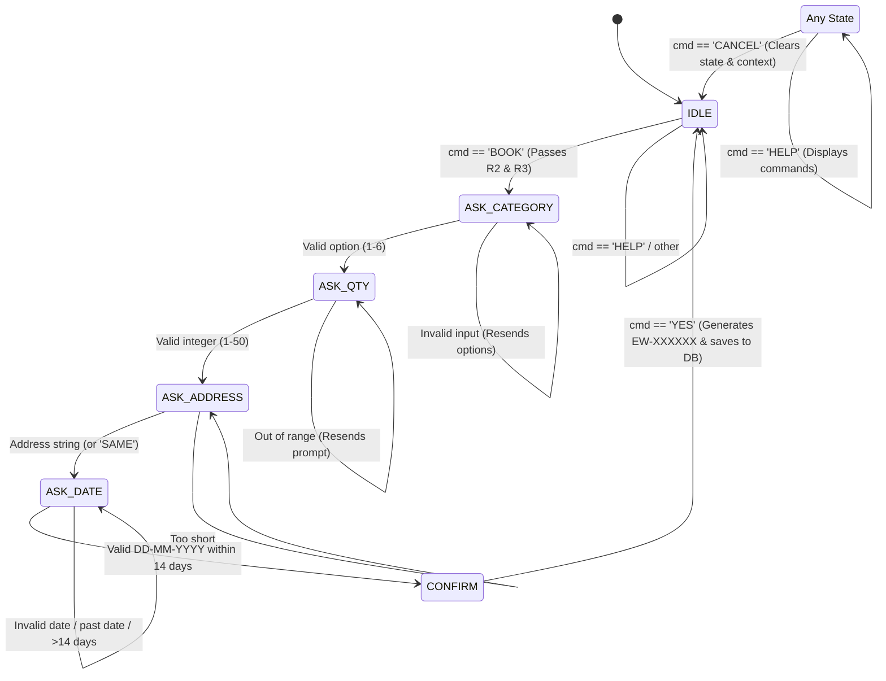

# Smart E-Waste Management Portal — Comprehensive Implementation & Architecture Plan

## 1. Executive Summary & System Overview

The **Smart E-Waste Management Portal** is a production-ready prototype enabling seamless e-waste collection. Instead of forcing users through multi-step web forms or app downloads, the portal adopts a **web-to-chat** conversion model:

1. **Client Registration (Web)**: User signs up on the responsive web portal with their name, email, and WhatsApp number.
2. **Instant Automation Trigger (Backend $\rightarrow$ n8n)**: The backend securely persists credentials in PostgreSQL and fires an authenticated internal webhook to n8n.
3. **Conversational Booking (WhatsApp)**: An automated WhatsApp bot (via Evolution API v2) greets the user. All subsequent scheduling (category selection, quantity, pickup address, pickup date, confirmation) happens conversationally within WhatsApp.
4. **Real-time Synchronization (PostgreSQL)**: Confirmed bookings are written directly to PostgreSQL with unique references (`EW-XXXXXX`) and instantly reflect on the client's web dashboard.
5. **Multi-layer Anti-Spam Engine**: Every inbound event is evaluated against 6 anti-abuse rules in n8n (flood limits, daily caps, pending limits, repeat offender bans) alongside web rate-limiting.

---

## 2. End-to-End System Architecture

```text
+-----------------------------------------------------------------------------------------+
|                                    SINGLE DOCKER NETWORK                                |
|                                                                                         |
|   +-----------------------+              HTTP POST                                      |
|   |   Browser (HTML/JS)   | ------------------------------------+                       |
|   +-----------------------+                                     |                       |
|               |                                                 v                       |
|               | Static Assets                    +-----------------------------+        |
|               v                                  |  Express API (Backend)      |        |
|   +-----------------------+                      |  Port 3000                  |        |
|   |  frontend/ (Mounted)  |                      +-----------------------------+        |
|   +-----------------------+                        |           |                        |
|                                         Auth/Read  |           | Webhook                |
|                                         SQL Query  v           v (Internal Secret)      |
|                       +-------------------------------+      +----------------------+   |
|                       |   PostgreSQL 16 (Port 5432)   |      |   n8n Automation     |   |
|                       |   - db: ewaste (App Data)     | <--->|   Port 5678          |   |
|                       |   - db: n8n (Workflows)       |      +----------------------+   |
|                       |   - db: evolution (Instances) |        |           ^            |
|                       +-------------------------------+        |           | Inbound    |
|                                       ^                        | Send      | Webhook    |
|                                       |                        | Text      |            |
|                       +-------------------------------+        v           |            |
|                       |   Redis 7 (Port 6379)         |<---> +----------------------+   |
|                       |   (Evolution Session Cache)   |      |   Evolution API v2   |   |
|                       +-------------------------------+      |   Port 8080          |   |
|                                                              +----------------------+   |
|                                                                        ^                |
|                                                                        | Baileys        |
|                                                                        v                |
|                                                                +--------------------+   |
|                                                                | Client's WhatsApp  |   |
|                                                                +--------------------+   |
+-----------------------------------------------------------------------------------------+
```

---

## 3. Repository File Structure

```text
ewaste-portal/
├── docker-compose.yml          # Container topology (postgres, redis, evolution-api, n8n, backend)
├── .env                        # Live environment configuration
├── .env.example                # Sanitized template
├── .gitignore                  # Ignores .env and node_modules
├── README.md                   # Setup guide and quick start
├── plan.md                     # Complete project documentation and status
├── db/
│   ├── 01-create-databases.sql # Initializes n8n and evolution databases
│   └── 02-schema.sql           # Schema: registrations, bookings, antispam_log
├── backend/
│   ├── Dockerfile              # Node 20 Alpine container definition
│   ├── package.json            # express, pg, bcrypt, jsonwebtoken, libphonenumber-js, etc.
│   ├── server.js               # Entrypoint, rate limiter (10 req/15min), static server
│   ├── db.js                   # Shared pg.Pool connection
│   ├── middleware/
│   │   └── auth.js             # JWT verification and req.userId extraction
│   └── routes/
│       ├── auth.js             # POST /api/register, POST /api/login
│       └── me.js               # GET /api/me, GET /api/my-bookings
├── frontend/
│   ├── index.html              # Landing page
│   ├── register.html           # Registration form
│   ├── login.html              # Login form
│   ├── dashboard.html          # Profile & live bookings table
│   ├── style.css               # Mobile-first CSS styling
│   └── app.js                  # Shared API client, auth guards, XSS protection
└── n8n/
    └── workflows/
        ├── 00-send-reply.json  # Sub-workflow: sends text via Evolution API (1500ms delay)
        ├── 01-welcome.json     # Registration listener: sends welcome text + instructions
        └── 02-bot.json         # State machine + 6 anti-spam rules + booking persistence
```

---

## 4. Phase-by-Phase Implementation Status & Bugs Fixed

### Phase 1: Database + Docker Skeleton
* **Implemented**:
  * Multi-database PostgreSQL setup (`ewaste`, `n8n`, `evolution`).
  * Docker compose orchestration binding internal communication (`postgres:5432`, `evolution-api:8080`, `n8n:5678`).
* **Bugs Encountered & Fixed**:
  * *Host Port Collision*: Host port 5432 was already occupied by a local PostgreSQL service. Fixed by mapping host port to `127.0.0.1:5433:5432` while keeping internal container port `5432`.
  * *Image Deprecation*: `atendai/evolution-api:v2.1.1` was relocated on Docker Hub. Migrated to official `evoapicloud/evolution-api:v2.1.1`.
* **Done When Verification**:
  * All 5 containers start up (`docker compose ps` shows `Up`).
  * `psql` lists `registrations`, `bookings`, `antispam_log`.

### Phase 2: Backend API (Node.js + Express)
* **Implemented**:
  * Phone number normalization with `libphonenumber-js` to strictly format numbers (e.g. `+91 98765 43210` $\rightarrow$ `919876543210`).
  * Password hashing via `bcrypt` (10 rounds).
  * Webhook dispatch to `N8N_WEBHOOK_URL` with custom `x-internal-secret` header.
  * Rate limiting (10 req / 15 min per IP) on `/api/register` and `/api/login`.
  * Protected `/api/me` and `/api/my-bookings` with JWT validation.
* **Done When Verification**:
  * `POST /api/register` returns `201`.
  * Duplicate email/phone returns `409 Conflict`.
  * `POST /api/login` returns valid JWT.
  * `GET /api/my-bookings` returns user-specific bookings.

### Phase 3: Frontend (Vanilla HTML/CSS/JS)
* **Implemented**:
  * `index.html`, `register.html`, `login.html`, `dashboard.html`.
  * Status badges: `PENDING` (orange), `CONFIRMED` (green), `PICKED_UP` (blue), `CANCELLED` (red).
  * Security: DOM content escaping via `escapeHtml` in `app.js` to eliminate stored XSS.
* **Done When Verification**:
  * Users can register, log in, view their profile, and inspect real-time bookings at `http://localhost:3000`.

### Phase 4: Evolution API Gateway Setup
* **Implemented**:
  * Instance `ewaste-bot` created via REST API with `WHATSAPP-BAILEYS` driver.
  * Inbound webhook mapped to internal Docker endpoint: `http://n8n:5678/webhook/wa-inbound`.
  * QR Code Manager available at `http://localhost:8080/manager`.
* **Done When Verification**:
  * `curl -X GET http://localhost:8080/instance/fetchInstances` returns instance `ewaste-bot`.
  * Inbound webhook is set for `MESSAGES_UPSERT` events.

### Phase 5: n8n Workflows & Chatbot State Machine
* **Implemented**:
  * `00-send-reply`: Centralized dispatch with 1.5s delay to safeguard against WhatsApp spam flags.
  * `01-welcome`: Webhook triggered by registration.
  * `02-bot`: Complete conversation state machine + 6 anti-spam rules.
* **Bugs Encountered & Fixed**:
  * *Bug 1: Invalid Webhook Response Mode*: n8n rejected `"responseMode": "immediately"`. Fixed by upgrading to valid mode `"onReceived"`.
  * *Bug 2: JSON Interpolation Breaking on Newlines*: In `00-send-reply`, interpolating raw text `"{{ $json.text }}"` broke on multiline strings. Fixed by using expression `={{ JSON.stringify({ number: $json.number, text: $json.text, delay: 1500 }) }}`.
  * *Bug 3: Inactive Sub-workflows*: Modern n8n requires sub-workflows invoked via `Execute Workflow` to be published. Fixed by publishing `00-send-reply` with `n8n publish:workflow`.
  * *Bug 4: Invalid IF Operator*: The condition in `Registered?` used `isNotEmpty` which is unsupported in n8n filter engine (defaulted to `false`, treating all users as unregistered). Fixed by replacing with `notEmpty`.
  * *Bug 5: Timeout Resilience*: Added `options.timeout = 8000` and `onError = "continueRegularOutput"` to `00-send-reply` so a disconnected WhatsApp session does not freeze the workflow engine.
* **Done When Verification**:
  * Live simulation verified: `BOOK` $\rightarrow$ `1` $\rightarrow$ `3` $\rightarrow$ address $\rightarrow$ date $\rightarrow$ `YES` successfully created booking `EW-8N34VS` in PostgreSQL.

---

## 5. Database Schema & Data Dictionary

### Table: `registrations`
| Column | Type | Constraints | Description |
| :--- | :--- | :--- | :--- |
| `id` | UUID | PRIMARY KEY, gen_random_uuid() | Unique user identifier |
| `full_name` | VARCHAR(100) | NOT NULL | Client's full name |
| `email` | VARCHAR(150) | NOT NULL, UNIQUE | User email address |
| `password_hash` | TEXT | NOT NULL | 10-round bcrypt hash |
| `whatsapp_number`| VARCHAR(20) | NOT NULL, UNIQUE | Digits with country code (e.g. `919876543210`) |
| `default_address`| TEXT | NULL | Saved address for quick auto-fill |
| `chat_state` | VARCHAR(20) | NOT NULL, DEFAULT `'IDLE'` | State machine stage |
| `chat_context` | JSONB | NOT NULL, DEFAULT `'{}'` | Temporary conversation memory |
| `is_blocked` | BOOLEAN | NOT NULL, DEFAULT `FALSE` | Abuse flag |
| `blocked_until` | TIMESTAMPTZ | NULL | Timestamp until which user is suspended |
| `created_at` | TIMESTAMPTZ | NOT NULL, DEFAULT `NOW()` | Registration timestamp |

### Table: `bookings`
| Column | Type | Constraints | Description |
| :--- | :--- | :--- | :--- |
| `id` | UUID | PRIMARY KEY, gen_random_uuid() | Unique booking identifier |
| `booking_ref` | VARCHAR(12) | NOT NULL, UNIQUE | Client reference code (`EW-XXXXXX`) |
| `registration_id`| UUID | NOT NULL, REFERENCES registrations | Cascade on user delete |
| `item_category` | VARCHAR(40) | NOT NULL | phone, laptop, battery, appliance, cables, other |
| `quantity` | INT | CHECK (quantity BETWEEN 1 AND 50) | Number of items |
| `pickup_address`| TEXT | NOT NULL | Pickup location |
| `pickup_date` | DATE | NOT NULL | Scheduled collection date |
| `status` | VARCHAR(20) | NOT NULL, DEFAULT `'PENDING'` | PENDING, CONFIRMED, PICKED_UP, CANCELLED |
| `created_at` | TIMESTAMPTZ | NOT NULL, DEFAULT `NOW()` | Booking creation timestamp |

*Index*: `idx_bookings_reg_created` on `(registration_id, created_at DESC)`.

### Table: `antispam_log`
| Column | Type | Constraints | Description |
| :--- | :--- | :--- | :--- |
| `id` | BIGSERIAL | PRIMARY KEY | Auto-incrementing log ID |
| `whatsapp_number`| VARCHAR(20) | NOT NULL | Sender WhatsApp phone number |
| `registration_id`| UUID | REFERENCES registrations | Nullable if sender is unregistered |
| `event_type` | VARCHAR(20) | NOT NULL | `MESSAGE`, `BOOKING`, `REGISTER` |
| `action` | VARCHAR(10) | NOT NULL | `ALLOWED`, `BLOCKED` |
| `reason` | VARCHAR(100) | NULL | `rate_limit`, `daily_booking_cap`, `pending_cap`, etc. |
| `created_at` | TIMESTAMPTZ | NOT NULL, DEFAULT `NOW()` | Event timestamp |

*Index*: `idx_spam_number_time` on `(whatsapp_number, created_at DESC)`.

---

## 6. Anti-Spam Rules Engine Specification

| Rule | Trigger Condition | System Action | SQL Verification Query |
| :--- | :--- | :--- | :--- |
| **R1: Message Flood** | $> 10$ messages in last 60 seconds | Set `blocked_until = NOW() + 15 min`, log `BLOCKED/rate_limit`, send warning. | `SELECT COUNT(*) FROM antispam_log WHERE whatsapp_number = $1 AND event_type = 'MESSAGE' AND created_at > NOW() - INTERVAL '60 seconds'` |
| **R2: Daily Booking Cap** | $> 3$ bookings in last 24 hours | Refuse booking, log `BLOCKED/daily_booking_cap`, inform user of limit. | `SELECT COUNT(*) FROM bookings WHERE registration_id = $1 AND created_at > NOW() - INTERVAL '24 hours'` |
| **R3: Pending Cap** | $> 2$ bookings with status `PENDING` | Refuse booking, log `BLOCKED/pending_cap`, request clearing existing pickups. | `SELECT COUNT(*) FROM bookings WHERE registration_id = $1 AND status = 'PENDING'` |
| **R4: Repeat Offender** | $\ge 3$ `BLOCKED` events in last 24h | Hard block: `is_blocked = TRUE`, `blocked_until = NOW() + 24 hours`. | `SELECT COUNT(*) FROM antispam_log WHERE whatsapp_number = $1 AND action = 'BLOCKED' AND created_at > NOW() - INTERVAL '24 hours'` |
| **R5: Unregistered Number**| Phone not found in `registrations` | Reply once with link to web portal; if $>3$ messages in 10 min, remain silent. | `SELECT id FROM registrations WHERE whatsapp_number = $1` |
| **R6: Currently Blocked** | `is_blocked = TRUE` AND `blocked_until > NOW()` | Discard incoming message silently without reply; log `BLOCKED/currently_blocked`. | Check `registrations.is_blocked` and `registrations.blocked_until` |

---

## 7. Chatbot Finite State Machine



---

## 8. Professor Demonstration Walkthrough (5-Minute Script)

1. **Architecture & Health**:
   * Show `docker compose ps` (all 5 containers running).
   * Open `http://localhost:3000` (website).
   * Show PostgreSQL databases (`\l` shows `ewaste`, `n8n`, `evolution`).
2. **Registration Flow**:
   * Go to `http://localhost:3000/register.html`.
   * Register: Full Name, Email, Password, WhatsApp Number (e.g. `+919876543210`).
   * Show network tab: `POST /api/register` returns `201`.
   * Show `registrations` table in PostgreSQL: record created with `chat_state = 'IDLE'`.
   * Show `antispam_log` table: record logged with `event_type = 'REGISTER'`, `action = 'ALLOWED'`.
3. **Conversational Booking (WhatsApp)**:
   * Scan QR in Evolution API manager (`http://localhost:8080/manager`).
   * On phone, message bot: `BOOK`.
   * Bot asks category $\rightarrow$ reply `1` (Phone).
   * Bot asks quantity $\rightarrow$ reply `2`.
   * Bot asks address $\rightarrow$ reply `123 Tech Park, Indiranagar`.
   * Bot asks date $\rightarrow$ reply future date within 14 days (e.g. `05-11-2026`).
   * Bot asks confirmation $\rightarrow$ reply `YES`.
   * Bot confirms: `Booked! Your reference is EW-XXXXXX`.
4. **Dashboard Verification**:
   * Log into `http://localhost:3000/login.html`.
   * Dashboard renders the newly generated `EW-XXXXXX` reference with status `PENDING`.
5. **Anti-Spam Verification**:
   * Send 11 rapid messages to bot $\rightarrow$ 11th message triggers 15-minute suspension (Rule R1).
   * Attempt 4th booking in 24 hours $\rightarrow$ bot refuses request (Rule R2).
   * Query an unregistered number $\rightarrow$ bot prompts registration once, then ignores flood (Rule R5).

---

## 9. Backup & Maintenance Runbook

* **Create Database Dump**:
  ```bash
  docker compose exec postgres pg_dump -U ewaste_user ewaste > backup.sql
  ```
* **Restore Database Dump**:
  ```bash
  cat backup.sql | docker compose exec -T postgres psql -U ewaste_user -d ewaste
  ```
* **Restart Services Without Data Loss**:
  ```bash
  docker compose down && docker compose up -d
  ```
  *(Named volumes `pgdata`, `evolution_instances`, and `n8n_data` ensure sessions, credentials, and records persist indefinitely).*
